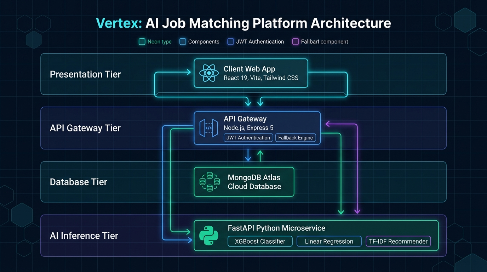
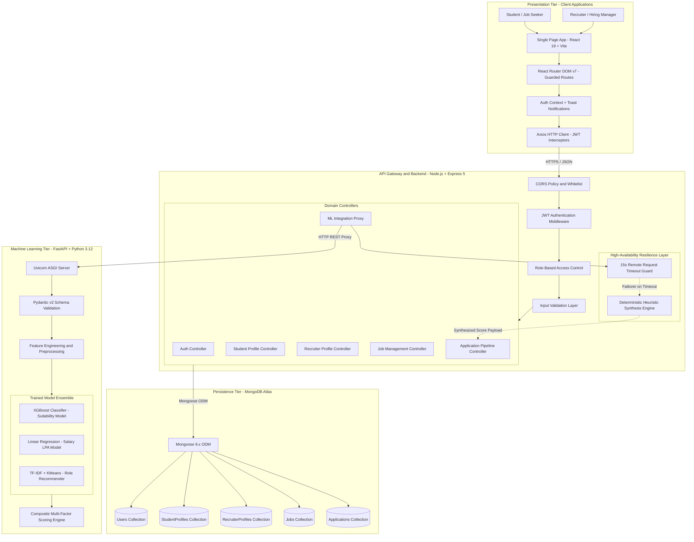
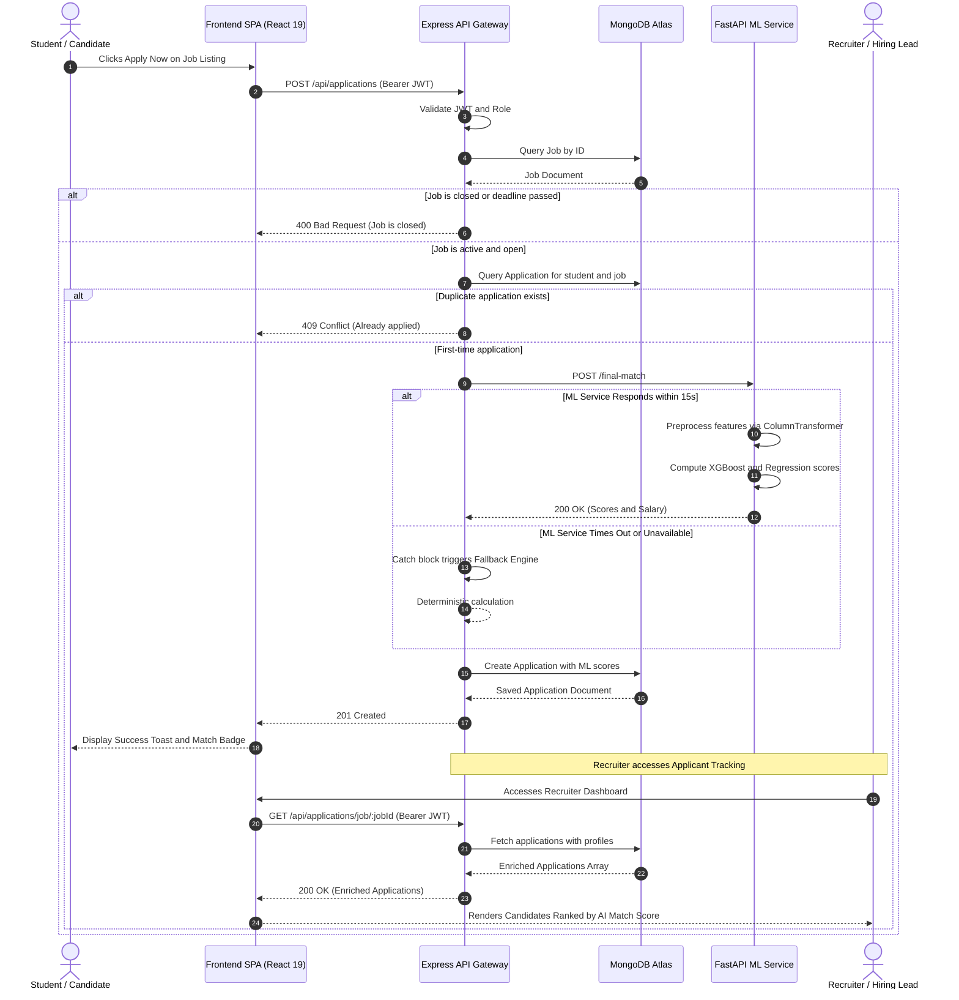
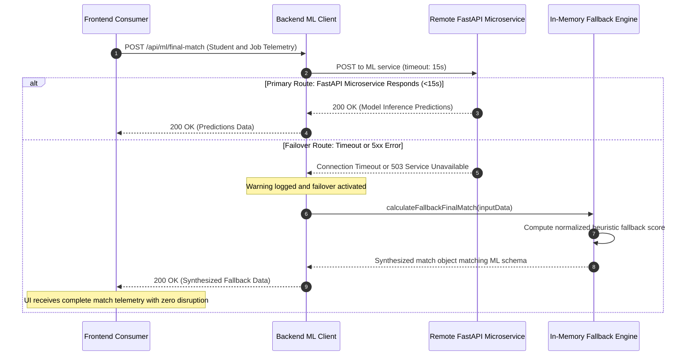
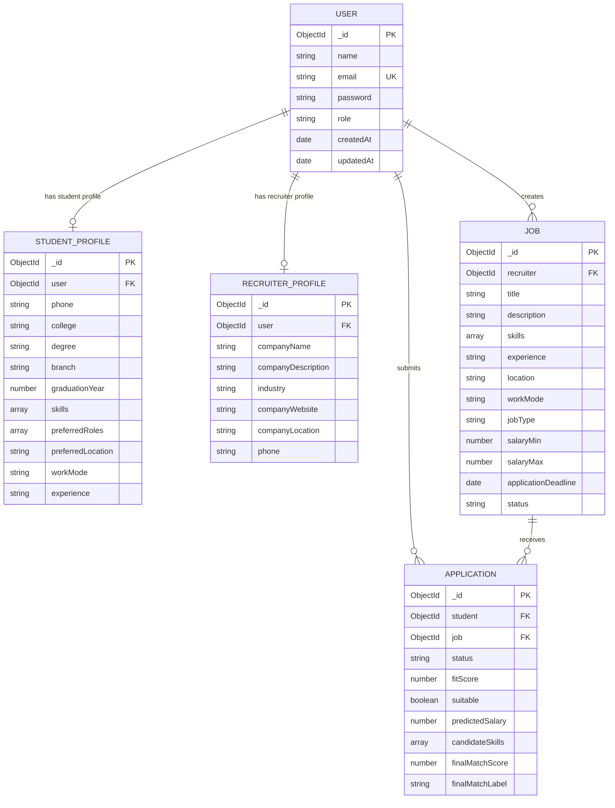

# Vertex — AI-Powered Job & Internship Matching Platform

[](https://react.dev/)
[](https://nodejs.org/)
[](https://www.mongodb.com/)
[](https://fastapi.tiangolo.com/)
[](https://scikit-learn.org/)
[](https://www.docker.com/)

**Vertex** is an end-to-end, AI-powered hiring and career-matching ecosystem designed to bridge the gap between students seeking internships/jobs and recruiters looking for talent. By leveraging a hybrid multi-model machine learning architecture (Supervised Classification, Regression, and Unsupervised Clustering), Vertex delivers objective, data-driven candidate-job match evaluation, salary benchmarking, and role recommendations.

---

## Table of Contents

- [Key Features](#key-features)
- [System Architecture](#system-architecture)
  - [High-Level Architectural Topology](#high-level-architectural-topology)
  - [Multi-Tier Architectural Breakdown](#multi-tier-architectural-breakdown)
  - [Inter-Service Communication & Protocols](#inter-service-communication--protocols)
  - [End-to-End Sequence & Data Flow Pipelines](#end-to-end-sequence--data-flow-pipelines)
  - [Database & Entity-Relationship Architecture](#database--entity-relationship-architecture)
  - [Resilience, Fault Tolerance & Failover Engineering](#resilience-fault-tolerance--failover-engineering)
  - [Security Architecture & Role-Based Access Control](#security-architecture--role-based-access-control)
- [Machine Learning Engine](#machine-learning-engine)
  - [Models & Techniques](#models--techniques)
  - [Composite Match Scoring Formula](#composite-match-scoring-formula)
- [Tech Stack](#tech-stack)
- [Repository Structure](#repository-structure)
- [API Reference](#api-reference)
  - [Backend REST API (Express)](#backend-rest-api-express)
  - [ML Microservice API (FastAPI)](#ml-microservice-api-fastapi)
- [Environment Variables](#environment-variables)
- [Getting Started & Local Setup](#getting-started--local-setup)
  - [Prerequisites](#prerequisites)
  - [1. Machine Learning Microservice Setup](#1-machine-learning-microservice-setup)
  - [2. Backend Setup](#2-backend-setup)
  - [3. Frontend Setup](#3-frontend-setup)
- [Docker Deployment](#docker-deployment)
- [License & Authors](#license--authors)

---

## Key Features

### For Students & Job Seekers
- **Dynamic Profile Builder:** Capture academic performance (CGPA, degree, branch, year), verified technical skills, GitHub repositories, competitive programming ratings, hackathon participation, and project portfolios.
- **Smart Job Search & Filtering:** Browse real-time job listings with location, work mode (remote/onsite/hybrid), job type (internship/full-time), and salary filters.
- **Instant AI Fit & Salary Prediction:** View your match compatibility score and estimated salary (LPA) before applying to any role.
- **Application Tracking:** Track application stages (`pending`, `shortlisted`, `accepted`, `rejected`) in real time.

### For Recruiters & Employers
- **Job Posting & Lifecycle Management:** Post, edit, close, and manage job listings with required skill taxonomies, experience thresholds, and application deadlines.
- **Applicant Analytics & Ranking:** View applicant pools automatically enriched with candidate profiles and objective AI suitability indicators.
- **Single-Click Candidate Decisioning:** Transition applicant statuses through structured hiring pipelines.

### ML Intelligence Hub (Interactive Simulation)
- **Student Simulator:** Test fit scores and salary projections interactively by tuning skills, experience, and academic metrics.
- **Recruiter Simulator:** Test skill-based role recommendation and comprehensive candidate-to-job matching with deep scoring breakdowns.

### High Availability & Resilient Architecture
- **Automatic Fallback Synthesis:** Backend features automated synthesis fallbacks so user workflows never crash even during ML microservice cold starts or latency spikes.

---

## System Architecture

<div align="center">
  
</div>

Vertex is designed around a **decoupled, microservices-oriented distributed architecture** separating high-concurrency asynchronous I/O and business CRUD operations (Node.js/Express) from compute-intensive numerical machine learning pipelines (Python/FastAPI).

### High-Level Architectural Topology



---

### Multi-Tier Architectural Breakdown

The system is separated into four primary layers:

#### 1. Presentation Tier (Frontend Client)
- **Framework & Bundler:** React 19 bootstrapped with Vite for lightning-fast HMR and optimized asset packaging.
- **Styling & UI:** Tailwind CSS v4 utility classes paired with Lucide React iconography.
- **Client Routing & Guards:** React Router DOM v7 providing client-side routing, code splitting, and `ProtectedRoute` higher-order components that verify JWT credentials and enforce role separation (`student` vs `recruiter`).
- **Communication Layer:** Centralized Axios instance with HTTP request interceptors automatically injecting JWT Bearer tokens and response interceptors handling unauthorized (`401`) redirects.

#### 2. Application & API Gateway Tier (Backend)
- **Runtime & Web Framework:** Node.js runtime executing Express 5.
- **Cross-Cutting Concerns:**
  - Dynamic CORS whitelist matching local development origins (`localhost:5173`, `localhost:3000`) and deployed Vercel domains.
  - Centralized JSON parsing and health probe monitoring (`GET /health`).
- **Security & Authorization Pipeline:** Stateless JWT authentication (`protect` middleware) extracting and verifying authorization tokens, coupled with `authorizeRoles` ensuring granular role-level isolation.
- **Domain Controllers:** Encapsulate business logic for authentication, profile management, job posting lifecycle, and applicant tracking.
- **ML Integration & Proxy Layer:** Routes all machine learning inference requests through authenticated backend proxies (`/api/ml/*`), insulating the ML microservice from public exposure while enforcing API rate, input sanity, and logging.

#### 3. Persistence Tier (Database)
- **Database Engine:** MongoDB Atlas (Cloud Managed NoSQL Document Database).
- **Object Data Modeling (ODM):** Mongoose 9.x providing strict schema definitions, type casting, validation, and lifecycle hooks.
- **Concurrency & Integrity Guarantees:** Compound unique indexing on `{ student: 1, job: 1 }` within the `Application` schema guarantees strict idempotency, eliminating duplicate job submissions even under high concurrency.

#### 4. Machine Learning Inference Tier (Python Microservice)
- **Web Layer:** FastAPI running on the Uvicorn ASGI server, exposing high-throughput RESTful endpoints with automatic OpenAPI/Swagger documentation.
- **Data Validation:** Pydantic v2 schemas executing strict type coercion, field constraints (`Field(ge=0)`), and dynamic feature calculation validators (`@model_validator`).
- **Inference Pipeline:**
  - Feature preprocessors (`ColumnTransformer`) mapping raw categorical inputs to numerical tensors.
  - High-performance gradient boosted decision trees (**XGBoost**) for classification.
  - Log-transformed Ordinary Least Squares regression for salary modeling.
  - Sparse TF-IDF matrix vectorization combined with **KMeans clustering** and **Cosine Similarity** for unsupervised role recommendation.

---

### Inter-Service Communication & Protocols

| Link | Communication Type | Protocol & Format | Authentication | Resilience / Fallback |
|:-----|:-------------------|:------------------|:---------------|:----------------------|
| **Frontend $\rightarrow$ Express Backend** | Asynchronous HTTP | HTTPS / JSON | Bearer JWT (Header) | Axios response interceptors & Toast error alerts |
| **Express $\rightarrow$ MongoDB Atlas** | Direct Socket / Connection Pool | Mongo Wire Protocol (TLS) | SCRAM-SHA-256 / URI Credentials | Automatic connection retries & pool management |
| **Express $\rightarrow$ FastAPI ML Service** | Synchronous REST Proxy | HTTP / JSON | Internal Network / Secured URL | 15s timeout guard with **Automatic Heuristic Fallback Synthesis** |
| **FastAPI $\rightarrow$ Serialized Models** | In-Memory Model Deserialization | Joblib Binary Loading | Local Filesystem Access | Preloaded at application startup |

---

### End-to-End Sequence & Data Flow Pipelines

#### Pipeline 1: Candidate Job Application & Real-Time AI Scoring

This diagram traces how a student's job application triggers end-to-end model inference, composite match evaluation, database persistence, and recruiter dashboard synchronization.



---

#### Pipeline 2: Fault-Tolerant Resilience & Graceful Degradation Failover

To guarantee 100% operational uptime—even when external ML services hosted on cloud tiers experience cold starts or intermittent network lag—the backend incorporates a **resilient failover proxy pattern**.



---

### Database & Entity-Relationship Architecture

The MongoDB document schema is structured to ensure referential consistency between accounts, profiles, job postings, and application records.



---

### Resilience, Fault Tolerance & Failover Engineering

Machine learning microservices deployed on elastic cloud tiers frequently undergo cold starts (dormant spin-up delays of 30–60 seconds). To eliminate single points of failure, Vertex implements **defense-in-depth availability**:

1. **Strict 15-Second Timeout Boundary:** Backend Axios requests to ML microservices are hard-capped at 15 seconds, preventing socket hanging or cascading worker thread starvation in Express.
2. **In-Memory Fallback Synthesis:** If the remote ML service is unreachable, times out, or returns a 5xx error, the backend transparently routes execution to an in-memory mathematical synthesis engine:
   - `calculateFallbackFinalMatch()`
   - `calculateFallbackClassification()`
   - `calculateFallbackRegression()`
   - `fallbackJobsList`
3. **Exact Schema Parity:** The fallback engine produces responses identical in structure, key names, and score normalization to the Python FastAPI service, ensuring the frontend client requires zero special error-handling branches.
4. **Automated Logging & Observability:** All failover occurrences log non-fatal warnings with endpoint metadata for debugging and monitoring.

---

### Security Architecture & Role-Based Access Control

Vertex enforces security across the network, application, and data layers:

- **Password Cryptography:** User passwords are encrypted with `bcryptjs` using cryptographically secure random salt rounds before storage. Passwords are set with `select: false` in Mongoose to prevent accidental serialization in queries.
- **JWT Authentication:** Sessions are maintained via cryptographically signed JSON Web Tokens (7-day validity) containing the user's `_id` and assigned `role`.
- **Role-Based Access Control (RBAC):**
  - **Student Access Only:** Profile creation (`POST /api/student/profile`), job applications (`POST /api/applications`), and student dashboard data.
  - **Recruiter Access Only:** Job posting (`POST /api/jobs`), applicant review (`GET /api/applications/job/:id`, `GET /api/applications/all`), and application stage management (`PATCH /api/applications/:id/status`).
  - **Ownership Authorization:** Recruiters can only modify, delete, or inspect applicants for jobs they own.
- **CORS Protection:** Express dynamically verifies request origins against strict whitelists with regex support for authorized local development ports.

---

## Machine Learning Engine

The ML core resides in `ML/` and combines multiple models trained on comprehensive student performance and employment datasets.

### Models & Techniques

1. **Candidate Fit Classification (`xgboost_classifier_best.pkl`):**
   - Algorithm: **XGBoost Classifier**
   - Inputs: Education level, years of experience, work mode preference, CGPA, project counts, internships, GitHub activity, hackathon participation, coding platform ratings, experience gap, and skill coverage.
   - Output: Probability score ($0.0 - 1.0$) and binary suitability flag ($\ge 0.5$).

2. **Salary Prediction Regression (`linear_regression_salary.pkl`):**
   - Algorithm: **Linear Regression** (log-transformed target)
   - Predicts estimated compensation in **LPA (Lakhs Per Annum)** based on experience, role, company size, academic performance, and technical activity scores.
   - Normalizes salary into a standard salary score ($2 - 30\text{ LPA}$ bounds).

3. **Job Recommendation Engine (`recommender.pkl`):**
   - Algorithm: **TF-IDF Vectorizer + KMeans Clustering + Cosine Similarity**
   - Extracts semantic features from candidate skill sets, classifies candidate into role clusters, and computes cosine similarity against job descriptions to recommend the top $N$ closest job opportunities.

### Composite Match Scoring Formula

For end-to-end applicant evaluation (`POST /final-match`), Vertex uses a weighted synthesis across three dimensions:

$$\text{Final Match Score} = (0.50 \times \text{Suitability}) + (0.30 \times \text{Skill Overlap}) + (0.20 \times \text{Salary Fit})$$

| Final Score Range | Match Classification |
|:------------------|:---------------------|
| $\ge 75\%$        | **Strong match**     |
| $55\% - 74.9\%$   | **Good match**       |
| $40\% - 54.9\%$   | **Moderate match**   |
| $< 40\%$          | **Weak match**       |

---

## Tech Stack

| Domain | Technology / Library |
|:-------|:---------------------|
| **Frontend** | React 19, Vite, Tailwind CSS v4, Lucide React, Axios, React Router DOM v7 |
| **Backend** | Node.js, Express 5, Mongoose ODM, JSON Web Token (JWT), bcryptjs, CORS |
| **Database** | MongoDB Atlas |
| **Machine Learning** | Python 3.12, FastAPI, Uvicorn, Scikit-learn, XGBoost, Pandas, NumPy, Joblib, Pydantic v2 |
| **DevOps / Tooling** | Docker, Nodemon, ESLint |

---

## Repository Structure

```plaintext
Ashish-project-mlcoe/
├── ML/                           # Machine Learning microservice & training notebooks
│   ├── app/                      # FastAPI routers, data schemas & model inference
│   │   ├── classification_api.py # XGBoost suitability endpoint
│   │   ├── regression_api.py     # Salary prediction endpoint
│   │   ├── final_match_api.py    # Multi-factor composite match endpoint
│   │   ├── recommend_api.py      # TF-IDF + KMeans recommendation endpoint
│   │   ├── loader.py             # Model loading and feature engineering logic
│   │   └── schemas.py            # Pydantic validation schemas
│   ├── models/                   # Serialized model artifacts (.pkl)
│   │   ├── xgboost_classifier_best.pkl
│   │   ├── linear_regression_salary.pkl
│   │   └── recommender.pkl
│   ├── Dockerfile                # Container definition with OpenMP (libgomp1)
│   ├── main.py                   # FastAPI application entrypoint
│   ├── requirements.txt          # Python dependencies
│   ├── EDA.ipynb                 # Exploratory Data Analysis notebook
│   ├── supervised .ipynb         # Classification & Regression training
│   └── Unsupervised_Learning.ipynb # Clustering & Recommender training
│
├── backend/                      # Node.js / Express REST API
│   ├── src/
│   │   ├── config/               # Database connection (Mongoose)
│   │   ├── controllers/          # Business logic (Auth, Jobs, Applications, Profiles, ML)
│   │   ├── middleware/           # JWT authentication & Role-Based Access Control (RBAC)
│   │   ├── models/               # Mongoose Schemas (User, StudentProfile, RecruiterProfile, Job, Application)
│   │   ├── routes/               # Express route declarations
│   │   ├── services/             # Microservice communication & fallback handlers
│   │   ├── validators/           # Request schema validations
│   │   ├── app.js                # Express app setup and middleware chain
│   │   └── server.js             # Server listener bootstrap
│   ├── package.json
│   └── .env                      # Backend configuration (create from example)
│
├── frontend/                     # Modern React Single Page Application (SPA)
│   ├── src/
│   │   ├── api/                  # Axios service integrations
│   │   ├── components/           # Reusable UI elements (Navbar, ML widgets, ProtectedRoute)
│   │   ├── context/              # Toast context and notifications
│   │   ├── pages/                # Route pages (Landing, Login, Signup, Dashboards, ML Hub)
│   │   ├── App.jsx               # Router & route definitions
│   │   └── main.jsx              # React DOM mounting
│   ├── index.html
│   ├── package.json
│   ├── vite.config.js
│   └── .env                      # Frontend configuration (create from example)
│
└── README.md                     # Project documentation
```

---

## API Reference

### Backend REST API (Express)

Base URL: `http://localhost:5000/api`

| Method | Endpoint | Access | Description |
|:-------|:---------|:-------|:------------|
| `GET` | `/health` | Public | Backend health check |
| `POST` | `/auth/register` | Public | Register new user (`student` or `recruiter`) |
| `POST` | `/auth/login` | Public | Login & receive JWT |
| `GET` | `/auth/me` | Protected | Fetch current logged-in user details |
| `POST` | `/student/profile` | Student | Create student profile |
| `GET` | `/student/profile` | Student | Get current student profile |
| `PUT` | `/student/profile` | Student | Update student profile |
| `POST` | `/recruiter/profile` | Recruiter | Create recruiter company profile |
| `GET` | `/recruiter/profile` | Recruiter | Get recruiter company profile |
| `PUT` | `/recruiter/profile` | Recruiter | Update recruiter profile |
| `GET` | `/jobs` | Public | List all open jobs with search/filters |
| `GET` | `/jobs/:jobId` | Public | Get single job details |
| `POST` | `/jobs` | Recruiter | Create a new job posting |
| `GET` | `/jobs/my` | Recruiter | List all jobs created by logged-in recruiter |
| `PUT` | `/jobs/:jobId` | Recruiter | Update an existing job posting |
| `DELETE` | `/jobs/:jobId` | Recruiter | Delete job posting |
| `PATCH` | `/jobs/:jobId/status` | Recruiter | Toggle job status (`open` / `closed`) |
| `POST` | `/applications` | Student | Apply to a job with AI match metrics |
| `GET` | `/applications/my` | Student | List applications submitted by current student |
| `GET` | `/applications/all` | Recruiter | List all applicants across recruiter's jobs |
| `GET` | `/applications/job/:jobId` | Recruiter | List applicants for a specific job |
| `PATCH` | `/applications/:id/status`| Recruiter | Update status (`pending`, `shortlisted`, `accepted`, `rejected`) |
| `POST` | `/ml/final-match` | Protected | Proxy call to ML final match engine |
| `POST` | `/ml/classification` | Protected | Proxy call to ML suitability classifier |
| `POST` | `/ml/regression` | Protected | Proxy call to ML salary predictor |
| `POST` | `/ml/recommendation` | Protected | Proxy call to ML job recommendation |

### ML Microservice API (FastAPI)

Base URL: `http://localhost:8000` (Docs available at `http://localhost:8000/docs`)

| Method | Endpoint | Description |
|:-------|:---------|:------------|
| `GET` | `/` | Service health status check |
| `POST` | `/classification` | Compute candidate fit score & suitability flag |
| `POST` | `/regression` | Compute predicted salary (LPA) and normalized salary score |
| `POST` | `/final-match` | Multi-factor weighted match computation ($0.50$ fit, $0.30$ skills, $0.20$ salary) |
| `POST` | `/recommend` | Recommend top $N$ matching job titles based on input skills |

---

## Environment Variables

### Backend Configuration (`backend/.env`)

```env
PORT=5000
MONGO_URI=mongodb+srv://<username>:<password>@cluster0.mongodb.net/Vertex?retryWrites=true&w=majority
# Comma-separated frontend origins when more than one deployment needs access
CORS_ORIGIN=http://localhost:5173
JWT_SECRET=your_super_secret_jwt_key
JWT_EXPIRES_IN=7d

# Microservice endpoints (local or deployed)
ML_FINAL_MATCH_URL=http://localhost:8000/final-match
ML_CLASSIFICATION_URL=http://localhost:8000/classification
ML_REGRESSION_URL=http://localhost:8000/regression
ML_RECOMMENDATION_URL=http://localhost:8000/recommend
```

### Frontend Configuration (`frontend/.env`)

```env
VITE_API_BASE_URL=http://localhost:5000
VITE_API_URL=http://localhost:5000
```

---

## Getting Started & Local Setup

### Prerequisites
- **Node.js** (v18.x or v20.x+)
- **Python** (v3.10, v3.11, or v3.12)
- **MongoDB** (Local instance or MongoDB Atlas cluster connection string)
- **Git**

---

### 1. Machine Learning Microservice Setup

Open a terminal in the root directory:

```bash
cd ML

# Create and activate a Python virtual environment
python -m venv venv

# On Windows (PowerShell):
.\venv\Scripts\Activate.ps1
# On macOS/Linux:
# source venv/bin/activate

# Install dependencies
pip install -r requirements.txt

# Run FastAPI development server
uvicorn main:app --reload --host 0.0.0.0 --port 8000
```

The ML server will start at `http://localhost:8000`. You can test endpoints via Swagger UI at `http://localhost:8000/docs`.

---

### 2. Backend Setup

Open a second terminal window:

```bash
cd backend

# Install npm dependencies
npm install

# Create/verify your .env file
# (Ensure MONGO_URI and JWT_SECRET are configured)

# Run the backend in development mode (with nodemon)
npm run dev
```

The Express API server will start on `http://localhost:5000`. Test health at `http://localhost:5000/health`.

---

### 3. Frontend Setup

Open a third terminal window:

```bash
cd frontend

# Install npm dependencies
npm install

# Start the Vite development server
npm run dev
```

Visit the application in your browser at `http://localhost:5173`.

---

## Docker Deployment

The ML microservice comes with a production-ready `Dockerfile` including the required `libgomp1` OpenMP runtime for XGBoost.

To build and run the ML microservice in Docker:

```bash
cd ML

# Build the Docker image
docker build -t vertex-ml-service .

# Run the container
docker run -d -p 8000:8000 --name vertex-ml vertex-ml-service
```

---

## License & Authors

- **Developed for:** ML Center of Excellence / Vertex Project
- **License:** ISC
- **Repository:** [ashish-dev-hub/Vertex](https://github.com/ashish-dev-hub/Vertex)
